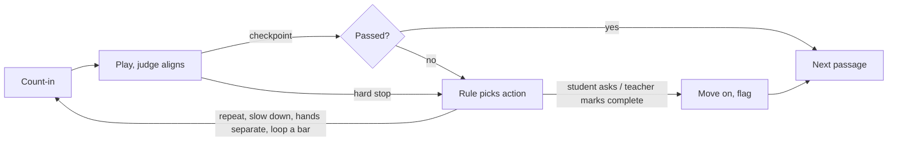

# Piano Tutor — Annotation & Grading Design

Oct 17, 2026 · Sam

Live doc: https://claude.ai/code/artifact/331d77af-5673-4666-a33f-75661e0ab7fd

## Overview

The app owns mistake detection and sensible default feedback; the teacher annotates only where a passage needs something different. Writing feedback scripts for every note on every page doesn't scale, and the riskiest part is detecting the mistake correctly, not wording the message.

So the design splits into three layers:

1. **Criteria**: what correct looks like. A default rubric, adjusted by the chosen teacher persona and by passage annotations.
2. **Diagnosis**: what went wrong, with a confidence level. The engine owns this; teachers never script it.
3. **Remediation**: what happens next, chosen from a small fixed set of actions.

## Plan so far

Seven decisions make up the current design; items 1 to 6 form the "fix my mistakes" drills milestone, built on the MIDI rater.

1. **Two roles.** Teacher mode is for annotating passages; student mode is for playing and getting feedback. In v1 you are both.
2. **Default rubric.** The judge grades every page against built-in criteria (notes, timing, rhythm, tempo), so unannotated pages still get feedback.
3. **Annotation mode.** A UI for per-passage overrides:
   - tighten or loosen a criterion, or mark it as required
   - set the passage's focus ("thumb crossing")
   - write custom feedback for a specific mistake
   - choose the restart point
   - adjust the reference notes: corrections, acceptable alternatives, or a demo take
4. **Teacher personas.** Kriti and Alex are presets that change tolerances and move-on behaviour. Your annotations beat the persona.
5. **Real-time judge.** It aligns incoming notes to the reference as you play. At each passage checkpoint it lists mistakes with confidence, and the feedback rules decide what happens next. It stops you mid-phrase only if things fall apart.
6. **Fixed set of actions.** Continue, repeat from a point, slow down, hands separately, loop a bar, or move on and flag it. Annotations and personas choose from this set; they can't script new behaviour.
7. **Later.** Label real takes for grader calibration, add an adaptive persona that tightens as you improve, and use an LLM only to word feedback, never to decide actions.

## Teacher personas

A persona is a preset of grading strictness, move-on rules, repeat behaviour and tone; the student picks one per piece. Each is a small settings file, so a third teacher is just another file.

|  | Kriti (strict) | Alex (relaxed) |
| --- | --- | --- |
| Timing tolerance | Tight | Loose |
| Which mistakes count | All, including small rhythm unevenness | Mainly wrong and missed notes, plus big timing slips |
| When to move on | After a clean run, maybe 2–3 in a row | When it's mostly right |
| Repeats | Keeps looping, slows down, splits hands | A couple of tries, then moves on and flags it |
| Feedback tone | Specific and corrective | Short and encouraging |

Guardrails:

- **Relaxed is not less accurate.** Alex still detects everything and lets more go, so progress tracking and the practice coach keep full information.
- **Kriti needs an escape route.** The student can ask to move on at any time, and the teacher can mark the passage complete; either moves on with the passage flagged. After many failed attempts she also suggests a break or a slower tempo.
- **Annotations win.** A criterion you mark as required can't be loosened by any persona.
- **Switching mid-piece.** Progress is shared across personas; only the bar for "done" changes.
- **Later:** an adaptive persona that starts like Alex and tightens toward Kriti as the piece improves.

## Data models

Four groups of models: the score (read-only), the rubric, the teacher layer, and the performance record. Everything points at stable note IDs from the score.

### 1. Score (MIDI for grading, MusicXML for notation)

```swift
struct Piece      { id; title; tempoBPM; timeSignature; measures: [Measure] }
struct Measure    { id; index; notes: [NoteEvent] }
struct NoteEvent  { id: NoteID; pitch; beatPosition; durationBeats; hand: .left/.right; velocity? }
struct ScoreRange { start: NoteID; end: NoteID }   // anchor for passages and rules
```

The judge grades against the reference MIDI; the page renders notation from MusicXML, or from image snippets where no MusicXML exists. Each NoteEvent keeps one ID linking its MIDI note to its MusicXML note, so annotations made on the notation anchor to the notes the judge grades. Image-only pages have no note IDs, so annotations there anchor to measures.

### 2. Rubric (what correct means)

```swift
enum Dimension { pitch, missedNote, extraNote, onsetTiming, duration,
                 rhythmEvenness, tempoStability, dynamics, articulation }

struct Criterion {
  dimension: Dimension
  tolerance: Double           // relative to the beat, e.g. 0.1 beat, not ms
  weight: Double
  inputModes: Set<InputMode>  // .midi, .mic; dynamics may be MIDI-only
}

struct Rubric   { criteria: [Dimension: Criterion]; passRule: PassRule }
struct PassRule { minScore: Double; cleanRunsRequired: Int }
```

One global default rubric ships with the app.

### 3. Teacher layer (personas and annotations)

```swift
struct TeacherPersona {               // JSON file, e.g. kriti.json
  id; name; tone
  toleranceScale: [Dimension: Double] // Alex = 1.5x looser
  ignored: Set<Dimension>             // Alex might ignore rhythmEvenness
  passRule: PassRule                  // Kriti: 2 clean runs
  remediationLadder: [RemediationAction]
  escapeAfterAttempts: Int            // so Kriti can't trap the student
}

struct AnnotationSet {                // one overlay file per piece, separate from book content
  pieceID; passages: [PassageAnnotation]
}

struct PassageAnnotation {
  id; range: ScoreRange; title?
  focus: String?                      // "thumb crossing"
  overrides: [Dimension: CriterionOverride]
  restartAt: NoteID?
  referenceOverride: ReferenceOverride?
  feedbackRules: [FeedbackRule]
}

struct CriterionOverride { tolerance?; weight?; locked: Bool } // locked = persona can't loosen

struct ReferenceOverride {
  replace: [NoteEvent]?                          // corrected notes
  acceptableAlternatives: [NoteID: [NoteEvent]]  // e.g. an ornament played either way
  demoTake: TakeID?                              // your recorded example
}

struct FeedbackRule {
  trigger: Trigger
  timing: .atCheckpoint | .immediate
  action: RemediationAction
  onRepeatFail: (after: Int, action: RemediationAction)?
}
struct Trigger { error: ErrorType; minSeverity; minConfidence; inputModes }

enum RemediationAction {
  case continueOn, repeat(from: NoteID), slowDown(scale: Double),
       handsSeparate(Hand), loopMeasure(MeasureID), moveOnAndFlag
  // each action can carry a message
}
```

The judge resolves one effective rubric per passage in this order: **default rubric → persona adjustments → annotation overrides**, with locked overrides always winning.

### 4. Performance record (what happened)

```swift
struct Take {                         // one attempt
  id; pieceID; passageID; personaID; inputMode; tempoScale
  events: [PlayedEvent]; startedAt
}
struct PlayedEvent    { pitch; onsetTime; duration?; velocity?; confidence } // confidence for mic
struct AlignmentMatch { refNote: NoteID?; played: PlayedEvent?; timingOffsetBeats } // nil = missed or extra

struct Finding {                      // one detected mistake
  type: ErrorType; range: ScoreRange; severity; confidence; measured: Double
}

struct TakeResult {
  scores: [Dimension: Double]; findings: [Finding]
  passed: Bool; firedRule: FeedbackRule?; chosenAction: RemediationAction
}

struct PassageProgress {              // per student, per passage
  attempts; cleanRunStreak; bestScore; flagged: Bool; lastPracticed
}

struct TakeLabel { takeID; teacherVerdict; correctedFindings; note } // later: grader calibration
```

## Where AI fits

AI supports the system rather than running it: the judge, the rubric and the choice of action stay deterministic code, so every piece of feedback traces back to a measurement.

| Use | Role | Priority |
| --- | --- | --- |
| Mic transcription | Turns audio into notes (pitches, onsets, chords) for the same judge MIDI feeds; small on-device model, tuned by the 30-second calibration | Essential for mic-only users |
| Grader calibration | Learns tolerances and weights from labelled takes; output is just rubric numbers | Important |
| Feedback wording | LLM words the message from findings, passage focus and persona tone; the rule has already chosen the action; falls back to templates | Nice to have |
| Practice coach | Rules rank weak passages from take history; LLM explains the suggestion | Later |
| Chat tutor | Answers questions about the piece using annotations and recent takes as context | Later |
| Teacher help | Suggests passage boundaries, focus and starting criteria from MusicXML; music recognition drafts MusicXML from image snippets | Later |

AI stays out of real-time mistake detection, the choice of what happens next, anything mid-phrase where latency matters, and overriding locked annotations or persona rules.

The transcription and calibration models are small and run on-device. The LLM uses are optional, so they can start on an API and move to a local model, keeping the fully-local goal reachable.

Build order: grader calibration, then mic transcription, then feedback wording, then the practice coach and chat tutor, then teacher help.

## Practice loop and design notes

The player is a plain state machine; the judge feeds it and feedback rules only choose transitions.



A failed checkpoint goes to the feedback rule, which loops back with an action; when the student asks to move on or the teacher marks the passage complete, the student moves on with the passage flagged.

Design notes:

- **Separate files.** Annotations and personas live outside the book content: no edits to licensed material, and easy to version in Git.
- **Store every take with its findings.** Cheap, and it feeds grader calibration and the "what to practise next" coach.
- **Stable note IDs first.** If IDs change on re-import, every annotation breaks; settle the ID scheme before building annotation mode.
- **Confidence gates.** A rule fires only above its confidence threshold; wrong feedback is worse than none, especially on mic input.

Built so far (feature/wrong-notes-and-midi-scores):

- **Wrong notes on the staff.** While a wrong key is held, a see-through red circle marks its line or
  space in the playhead's column; it goes on note-off, so the player corrects it themselves. Book pages use staff lines found in the page image, or an
  optional per-measure `staff` placement in the annotations (and an optional passage `clef`).
- **Any MIDI file as a score.** Opening a MIDI file transcribes it (`Transcriber`), lays it out
  (`ScoreLayout`) and engraves it (`ScoreRenderer`, a platform-neutral display list drawn by the app
  and exportable as SVG). Wait mode uses the existing guide. `MusicXMLWriter` saves the transcription,
  so stable note IDs can later come from the MusicXML side of the same score.

Open questions:

- [ ] Score formats: MIDI for grading, MusicXML (or image snippets) for notation. Still open: how MusicXML notes map to MIDI notes so both share one note ID?
- [x] Decided: v1 annotation mode is a simple UI over the overlay JSON.
- [ ] How many clean runs does Kriti require? Escape is decided: the student asks to move on, or the teacher marks the passage complete.
